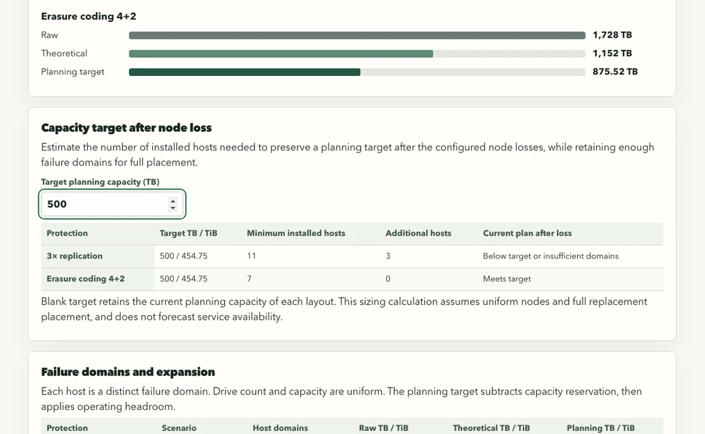
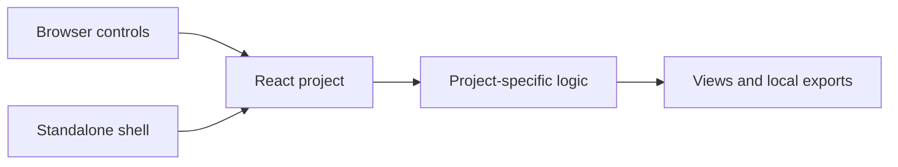

# StorageCalc

Compare replication and erasure coding, model a node outage, and quantify expansion headroom.

[Live demo](https://paragjindal.com/lab/storagecalc) · [Technical case study](docs/projects/storagecalc.md)



## Run independently

Use Node.js 24 or later from this repository root. npm installs React and Vite from their pinned registry dependencies and the simulator from its included archive.

```sh
npm ci
npm run dev
```

Open [http://localhost:5173](http://localhost:5173). Run `npm test` for the package regression suite and `npm run build` for a static production bundle.

To use Docker, build with `docker build -t storagecalc .` and run with `docker run --rm -p 127.0.0.1:4173:80 storagecalc`. The static browser application is served on port 4173.

## Architecture



The browser uses synthetic demonstration data. Optional local adapters are documented in the case study. The archive retains its source, tests, installation lock, and GitHub Actions configuration. A redistribution license has not been declared.

[Release notes and verified source provenance](docs/release-provenance.md)
